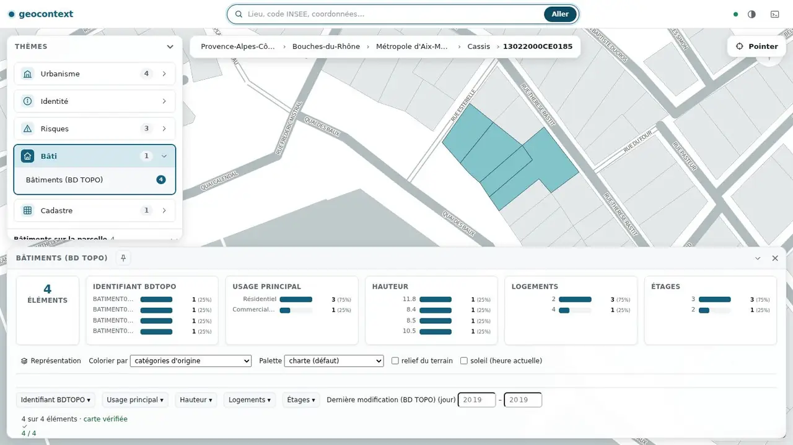

# geocontext

Un serveur MCP expérimental fournissant du contexte spatial pour les LLM.

## Motivation

Les LLM renforcent l'idée que la magie est possible avec l'informatique. Il n'en est rien. Pour qu'un assistant soit en mesure de connaître la date et l'heure, il faut par exemple l'interfacer avec un [MCP time](https://mcpservers.org/servers/modelcontextprotocol/time). De même, pour qu'il soit en mesure de lire une page, il faut par exemple l'interfacer un [MCP fetch](https://github.com/modelcontextprotocol/servers/tree/main/src/fetch#readme).

En matière de données géographique, si un utilisateur pose une question impliquant que l'assistant soit en mesure de [connaître la position d'une adresse, il y a de bonne chance que la réponse soit plausible mais fausse](https://github.com/mborne/llm-experimentations/tree/main/chatgpt-geocodage-limites#readme).

S'il est techniquement possible de brancher des API REST/GeoJSON telle APICARTO, la conception de ces dernières n'est pas adaptée (5000 résultat par défaut, grosse géométrie dans les réponses, géométries complexes à fournir,...).

L'idée est ici d'**expérimenter la conception d'un MCP rendant les données et les services de la Géoplateforme accessibles par un LLM**.

## Mises en garde

- Ce développement est un POC en incubation avec IgnFab (archivage en cours de [mborne/geocontext](https://github.com/mborne/geocontext))
- S'il s'avère utile de l'industrialiser, le dépôt sera migré sous responsabilité IGN et l'outil sera renommé (ex : `IGNF/mcp-gpf-server`)
- Plusieurs problèmes et améliorations possibles ont été identifiés et sont en cours de mitigation/résolution (c.f. [issues](https://github.com/ignfab/geocontext/issues?q=is%3Aissue%20state%3Aopen%20label%3Ametadata)).
- Cet outil n'est pas magique (voir [Fonctionnalités](#fonctionnalités) pour avoir une idée de ses capacités)

## Principes de conception

- **Ne pas copier les données de la Géoplateforme** (but : identifier les améliorations possibles sur le services plutôt que les doublonner)
- **Limiter au maximum la taille des réponses** (but : optimiser le nombre de jeton / éviter les hallucinations / pouvoir utiliser des modèles locaux)
- **Dire ce qui est vérifié** : un résultat est soit complet et contrôlé, soit refusé avec un message ; jamais approché en silence (voir [territoire-exact.md](docs/territoire-exact.md)).
- **Un seul contexte pour tous les clients** : client MCP, interface web et agent intégré agissent sur la même session.

## Ce que fait cette version

Au-delà des services unitaires du projet d'origine, cette version ajoute une **navigation territoriale** (région → département → EPCI → commune → parcelle), un **registre de 49 sources** réparties en 10 thèmes, une **interface web** (carte, tableaux, filtres, représentations), un **agent intégré** et une **MCP App**. Les données restent chez leur producteur.



- Présentation illustrée : [docs/vitrine/index.html](docs/vitrine/index.html)
- Guide d'ensemble (architecture, méthode, MCP, agent) : [docs/guide-technique.md](docs/guide-technique.md)
- État, limites et usages : [docs/usages-professionnels.md](docs/usages-professionnels.md)

C'est un prototype : voir les limites connues dans le guide.

## Utilisation

### Utilisation de la version publiée

Cette commande installe la version publiée du projet d'origine. Pour utiliser cette version-ci, passer par la construction locale (section « Développement »).

Par exemple, avec "Cursor Settings / MCP / Add server" :

```json
{
  "mcpServers": {
    "geocontext": {
      "command": "npx",
      "args": ["-y", "@ignfab/geocontext"]
    }
  }
}
```

### Utilisation avec Docker

```bash
docker compose build
docker compose up -d
```

Ensuite :

```json
{
  "mcpServers": {
    "geocontext": {
      "url": "http://localhost:3000/mcp"
    }
  }
}
```

## Documentation

| Document | Contenu |
|---|---|
| [docs/guide-technique.md](docs/guide-technique.md) | Guide d'ensemble : architecture, méthode, MCP, agent |
| [docs/vitrine/index.html](docs/vitrine/index.html) | Présentation illustrée |
| [docs/structures.md](docs/structures.md) | Les pièces du dépôt : contexte, serveur MCP, MCP App, interface web |
| [docs/dynamic-tools.md](docs/dynamic-tools.md) | Les sept outils et leurs valeurs contextuelles |
| [docs/web-interface.md](docs/web-interface.md) | Interface web : disposition, tableaux, représentations, agent |
| [docs/api-http-agent.md](docs/api-http-agent.md) | Routes HTTP, agent intégré, sécurité, état de la recherche |
| [docs/territoire-exact.md](docs/territoire-exact.md) | Appartenance exacte à un territoire : règles et limites |
| [docs/usages-professionnels.md](docs/usages-professionnels.md) | Ce qui est fiable, ce qui ne l'est pas |
| [docs/architecture.md](docs/architecture.md) | Architecture générale |

## Développement

### Construction de la version locale

```bash
git clone https://github.com/ignfab/geocontext
cd geocontext
npm install
npm run build
```

### Utilisation de la version locale

```json
{
  "mcpServers": {
    "geocontext": {
      "command": "node",
      "args":["/chemin/absolu/vers/geocontext/dist/index.js"]
    }
  }
}
```

### Interface web et agent

```bash
TRANSPORT_TYPE=http npm start
# → http://localhost:3000
```

L'interface fonctionne sans modèle de langage. L'agent intégré s'active en renseignant `AGENT_LLM_BASE_URL`, `AGENT_LLM_MODEL` et `AGENT_LLM_API_KEY` (API de type « chat completions »). Le mode `http` n'a **pas d'authentification** : ne pas l'exposer tel quel (voir [docs/api-http-agent.md](docs/api-http-agent.md)). Les cartes chargent le composant Atlas depuis un site tiers et les fonds depuis la Géoplateforme : un accès réseau sortant est nécessaire.

### Tests

```bash
npm test
```

Une partie des tests appelle la Géoplateforme réelle (réseau nécessaire).

### Debug de la version locale

```bash
npx -y @modelcontextprotocol/inspector node dist/index.js
```

## Paramétrage

Pour une utilisation avancée :

| Nom              | Description                                                                                                          | Valeur par défaut |
| ---------------- | -------------------------------------------------------------------------------------------------------------------- | ----------------- |
| `TRANSPORT_TYPE` | [Transport](https://mcp-framework.com/docs/Transports/transports-overview) permet de choisir entre "stdio" et "http" | "stdio"           |
| `PORT`           | Port du mode `http`                                                                                                  | 3000              |
| `PUBLIC_BASE_URL`| Adresse publique de l'interface, citée dans les textes d'outils                                                      | `http://localhost:<PORT>` |
| `AGENT_*`        | Agent intégré : modèle, bornes, quotas (voir [docs/api-http-agent.md](docs/api-http-agent.md))                      | agent désactivé   |

## Fonctionnalités

### Outils exposés par le serveur

Sept outils, toujours listés, dont les descriptions et valeurs autorisées dépendent du contexte ([détails](docs/dynamic-tools.md)) :

| Outil | Rôle |
|---|---|
| `navigate` | résoudre un territoire : nom, code INSEE, coordonnées, identifiant de parcelle, département, SIREN d'EPCI |
| `action` | charger un thème (identité, urbanisme, cadastre, risques, environnement, transport, hydrologie, bâti, énergie, économie) ou une donnée précise |
| `map` | afficher, masquer, filtrer une couche ; le résultat est l'état relu sur la carte |
| `compare` | croiser deux thèmes sur le même territoire |
| `select` | se positionner sur un objet chargé |
| `search` | rechercher un lieu, une donnée ou un type de couche |
| `back` | revenir à l'état précédent |

> Ex : « Quels sont les zonages du PLU de Cassis ? » puis « Garde seulement les zones U. »
>
> Ex : « Combien de bâtiments sur la parcelle 13022000CE0185, et quels usages ? »

### Projet d'origine : outils par service

Le projet d'origine exposait un outil par service de la Géoplateforme (`geocode`, `altitude`, `adminexpress`, `cadastre`, `urbanisme`, `assiette_sup`, `gpf_wfs_list_types`, `gpf_wfs_search_types`, `gpf_wfs_describe_type`, `gpf_wfs_get_features`). Leur code est conservé dans [src/tools/](src/tools/) et la version publiée sur npm les expose ; **le serveur de cette version ne les expose plus**, la navigation et les sources du registre s'appuient sur les mêmes clients ([src/gpf/](src/gpf/)).

## Contribution

### Problèmes et demandes d'évolutions

N'hésitez pas à [créer une issue](https://github.com/ignfab/geocontext/issues) si vous rencontrez un problème! Merci de fournir :

- L'assistant et le modèle utilisé
- La demande que vous faite à l'assistant (ex : "Combien y a-t'il de pont franchissant la seine?")

### Proposer une nouvelle fonctionnalité

N'hésitez pas :

- Forker le dépôt
- Créer un nouveau tool
- Tester de votre côté
- Faire une pull-request


## Crédits

* [mcp-framework](https://mcp-framework.com) fournit le **cadre de développement du MCP** :

```bash
# Par exemple, pour exposer la liste des couches WMTS
mcp add tool gpf_wmts_layers
```

* [@camptocamp/ogc-client](https://camptocamp.github.io/ogc-client/#/) pour la **lecture des réponses XML des services WFS, WMTS,...**
* [MiniSearch](https://github.com/lucaong/minisearch) pour la **recherche par mot clé**.
* [jsts](https://bjornharrtell.github.io/jsts/) pour les **traitements géométriques** (ex : tri des réponses par distance au point recherché).

## Licence

[MIT](LICENSE)


