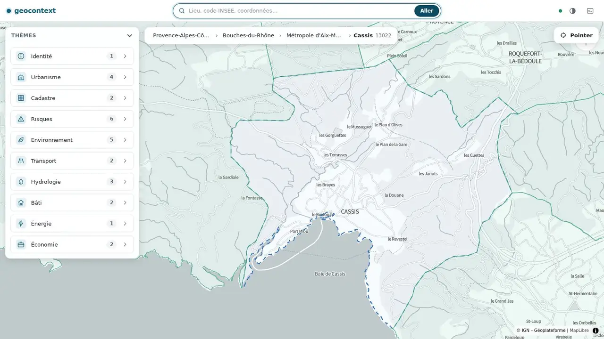
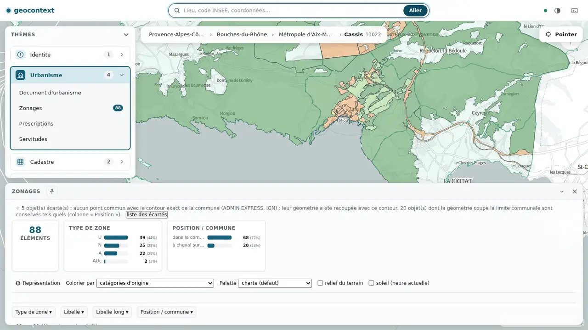
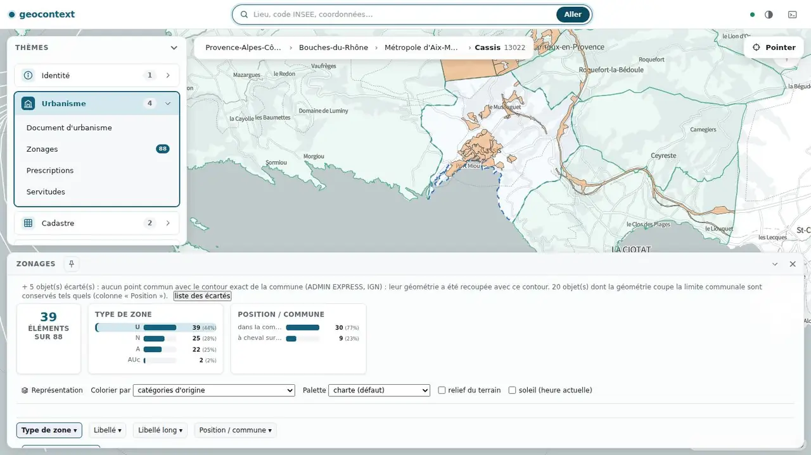
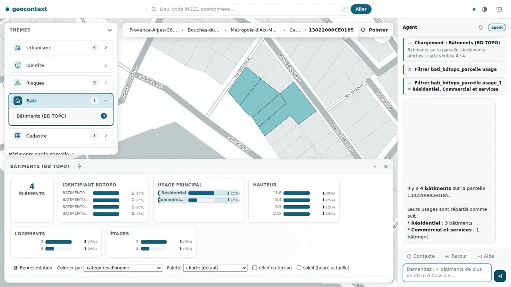

# Interface web

Application sans étape de compilation (JavaScript natif), servie par le mode `http` du serveur. Elle parle au serveur par `/mcp`, comme n'importe quel client MCP, et partage **le même contexte de session** que l'agent intégré et les clients MCP. Vue d'ensemble : [guide-technique.md](guide-technique.md).

## Disposition

| Zone | Contenu | Fichier |
|---|---|---|
| Barre supérieure | recherche (nom, code INSEE, coordonnées, identifiant de parcelle), thème clair/sombre, ouverture de l'agent | `app.js` |
| Panneau « Thèmes » (gauche) | thèmes disponibles pour le niveau courant, avec le nombre de couches ; actions d'un thème | `context-panel.js` |
| Fil territorial (haut) | région › département › EPCI › commune › parcelle ; chaque maillon ramène à ce niveau | `context-panel.js` |
| Carte | composant externe `<atlas-bi>` ; bouton « Pointer » pour naviguer vers un point cliqué ; bulle « Naviguer » sur les contours de contexte | `map-atlas.js` |
| Panneau de données (bas) | statistiques, filtres, tableau, représentation, export, objets écartés | `data-panel.js` |
| Agent (droite) | conversation, étapes exécutées et leur résultat | `chat.js` |

Les contours de contexte affichés sur la carte changent avec le zoom (région, département, EPCI, commune). Une carte MapLibre simple reste disponible avec `?carte=maplibre` (`map.js`).

## Données, filtres et vérification

Chaque couche chargée apparaît dans le panneau de données : un total, des statistiques par champ (catégories, minimum/maximum, valeurs absentes), des filtres par champ et un tableau. Quand la couche a une date, un axe temporel s'ajoute.

- **Tableau = carte.** Après chaque chargement, filtre ou coloration, le nombre d'objets lus sur la carte est comparé à celui du tableau ; en cas d'écart, l'opération est annulée avec un message. Si la carte ne peut pas être relue, la page le dit.
- **Objets écartés.** Pour les couches à territoire exact, les objets hors du contour sont écartés et listés (« liste des écartés ») ; ceux qui chevauchent la limite sont conservés et marqués (voir [territoire-exact.md](territoire-exact.md)).
- **Zone visible.** La case « Limiter à la zone visible » restreint le tableau aux objets dont la géométrie touche la fenêtre de la carte.
- **Tableau ↔ carte.** Survoler une ligne du tableau surligne l'objet sur la carte ; cliquer un objet de la carte sélectionne sa ligne.
- **Export.** Les lignes retenues sont exportées en CSV, avec le total et les filtres en note.

## Représentation d'une couche

Le bloc « Représentation » du panneau de données est affiché pour **toute** couche (points, lignes, surfaces) :

| | Points | Lignes | Surfaces |
|---|---|---|---|
| Colorier par champ numérique (quantiles, 3 à 7 classes) | oui | oui | oui |
| Colorier par valeur d'un champ catégoriel (2 à 12 valeurs) | oui | oui | oui |
| Palette | oui | oui | oui |
| Cercles proportionnels, chaleur, hexagones, grille | oui | non | non |
| Relief du terrain, soleil | oui | oui | oui |

Chaque coloration compare les comptes de la légende lue sur la carte à ceux du tableau et s'annule avec un message s'ils diffèrent. Les valeurs absentes forment une classe grise « (sans valeur) ». Un champ catégoriel de plus de 12 valeurs est proposé grisé, avec la raison. Les chaleurs, hexagones et grilles ne concernent que les points : une couche de surfaces n'y est pas représentée par ses centroïdes. Le type de la couche est contrôlé sur tous ses objets ; une couche à géométries mixtes est refusée avec un message.

## Agent

Le panneau de droite pilote l'**agent intégré** (voir [api-http-agent.md](api-http-agent.md)) : il enchaîne les mêmes outils que le serveur MCP et agit sur la même session, donc sur ce qui est à l'écran. Chaque étape (navigation, chargement, filtre) s'affiche avec son résultat, y compris une erreur ; la page **accuse ce qu'elle a réellement affiché** avant que l'agent poursuive.

Sans modèle configuré, le panneau indique « sans agent » ; tout le reste fonctionne.

## Mode sans LLM

La navigation, les panneaux, les tableaux, les filtres et l'export fonctionnent sans modèle de langage ; seul l'agent est désactivé.

## Intentions de conception (non implémentées)

Ces éléments figuraient dans la conception d'origine. Ils ne sont pas réalisés ; les valeurs des maquettes sont illustratives.

- Navigation par zoom seul, sans sélecteur de niveau (le zoom pilote aujourd'hui l'affichage des contours, pas le niveau navigué).
- Fiches détaillées par niveau (commune, parcelle, bâtiment) regroupant thèmes, transactions et énergie sur une seule vue.
- Navigation vers un bâtiment (le niveau existe dans le modèle ; l'identifiant BD TOPO est refusé explicitement).
